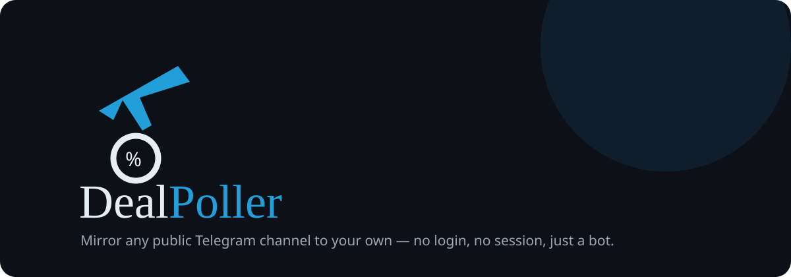
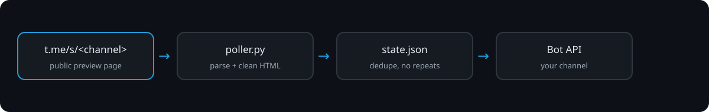

# DealPoller



<p>
  
  
  
  
</p>

**Mirror any public Telegram channel into your own — without logging in.** Most channel-mirror tools want your Telegram account: an API id, a session file, your account at risk. DealPoller takes the other road. Every public channel has a public preview page (`t.me/s/<channel>`); DealPoller polls it, cleans each new post into Telegram-safe HTML, and reposts it to your channel through a bot. **No session. No user account. One bot token, kept in an environment variable and never written to disk.**



## Quick start

1. Create a bot with [@BotFather](https://t.me/BotFather), add it as an **admin** of your target channel.
2. Clone this repo and copy the example config:
   ```bash
   git clone https://github.com/iSahinul/DealPoller.git
   cd DealPoller
   cp config.example.json config.json   # set your channel + the source channel
   ```
3. Export the token and run:
   ```bash
   export TELEGRAM_BOT_TOKEN="123456:ABC..."   # from BotFather; never commit this
   python3 poller.py
   ```

The **first run only seeds its state** — it notes the newest existing post and mirrors nothing. From then on, every new source post appears in your channel within one poll interval. Try `POLLER_DRY_RUN=1 POLLER_ONCE=1 python3 poller.py` first to see it parse without sending anything.

## Configuration

`config.json`:

| Field | Meaning |
|---|---|
| `channel` | Your target channel, e.g. `@mychannel` (the bot must be an admin) |
| `source` | Preview URL of the source channel: `https://t.me/s/<name>` |
| `poll_seconds` | How often to check (default 90; be polite, this is plenty) |
| `caption_limit` | Max caption length before truncation (default 1000) |

Environment: `TELEGRAM_BOT_TOKEN` (required), `POLLER_DRY_RUN=1`, `POLLER_ONCE=1`, `POLLER_CONFIG` (alternate config path).

## Behaviour worth knowing

- **Dedupe is a watermark, not a database.** `state.json` holds the highest mirrored message id. A post is marked done only after it sends successfully; a failure stops the cycle and retries next round — nothing is skipped silently, nothing posts twice.
- **Photos have a fallback.** Telegram's servers sometimes refuse to fetch preview-CDN image URLs. When that happens, DealPoller downloads the image itself and re-uploads it; if the image is truly dead, the post goes out text-only rather than stalling the queue.
- **Captions are cleaned, not copied raw.** Preview-page HTML is converted to the small HTML subset the Bot API accepts; everything else is stripped, entities are handled safely.
- **The parser is depth-safe.** A plain `<br>` (not `<br/>`) inside a caption cannot silently eat a message — a real bug class in naive parsers, fixed and tested here.

## Respect the source

Mirror channels you have the right to mirror — your own channels, partners who agreed, or sources whose terms allow it. Keep the poll interval sane. This tool reads a public page politely; it does not bypass anything, log in as anyone, or touch private channels (preview pages exist only for public ones).

## Give it to your AI

Paste this into Claude, ChatGPT or Codex and let your assistant do the setup:

```text
Set up DealPoller from this repo. Read skill/SKILL.md first. Ask me for
the source channel and my target channel, create config.json, and run
one dry-run cycle to show me what would be mirrored. My bot token goes
in the TELEGRAM_BOT_TOKEN environment variable only - never write it
into any file, and never ask me to paste it into this chat.
```

## Use it as an agent skill

This repo ships a `SKILL.md` (in the `skill/` folder) in the open Agent Skills format — the same file works in Claude, ChatGPT and Codex. Install the skill and your AI assistant learns the safety rules on its own: token only from the environment, first run seeds silently, failures stop the cycle.

Copy the `skill/` folder into your agent's skills directory (for example `~/.claude/skills/dealpoller/` or `~/.agents/skills/dealpoller/`), keeping `SKILL.md` inside it.

## What has been tested

The parser and HTML cleaner are covered by unit tests, including a fixture shaped like real `t.me/s/` markup. The parser was also run against a live public channel page (20/20 posts extracted, photos included). The send path — including the photo re-upload fallback — comes from a production mirror that has run daily since October 2026. Your first live run should still be a dry run; channels differ.

## Roadmap

- Optional link rewriting hook (run each post's links through your own converter before posting)
- Multiple sources → one target channel
- A watchdog-friendly single-file mode for cron

## About the creator

**Built by Sahinul Islam Laskar** — I run content sites and the automation behind them: SEO measurement, price tracking and deal monitoring. DealPoller is the mirroring core of a live deals operation that republishes a public deals channel to a curated one around the clock, extracted and open-sourced because the no-login approach deserves to be the default.

[GitHub](https://github.com/iSahinul) · [LinkedIn](https://www.linkedin.com/in/isahinul/) · [X (@iSahinul)](https://x.com/iSahinul)

## License

MIT — see [LICENSE](LICENSE).
